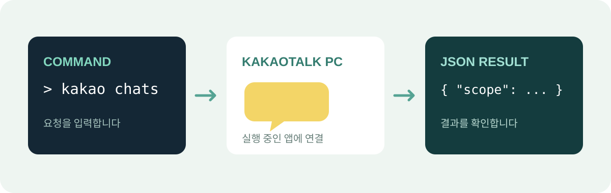

<p align="center">
  
</p>

<h1 align="center">Kakao Bridge</h1>

<p align="center">
  <strong>PC 카카오톡을 명령줄과 AI 작업 흐름에 연결합니다.</strong><br>
  화면과 Windows 기능을 활용하는 공개 시험판입니다.
</p>

<p align="center">
  
  
  <a href="https://github.com/contentriumkorea/Kakao-Bridge/releases/tag/v0.2.0-alpha.1"></a>
</p>

<p align="center">
  <a href="#빠르게-시작하기">빠르게 시작하기</a> ·
  <a href="#전송하기">전송하기</a> ·
  <a href="#ai-에이전트에서-사용하기">AI 스킬</a> ·
  <a href="#제한과-개인정보">제한과 개인정보</a>
</p>

---

## 빠르게 시작하기

Windows x64, 로그인된 PC 카카오톡과 Windows 한글 OCR이 필요합니다. [시험판 릴리스](https://github.com/contentriumkorea/Kakao-Bridge/releases/tag/v0.2.0-alpha.1)에서 ZIP을 내려받아 압축을 풀고, 해당 폴더에서 PowerShell을 엽니다.

```powershell
.\kakao.cmd status
.\kakao.cmd open-chats
.\kakao.cmd screen
```

`status` 결과의 `edition`은 `public_preview`입니다. 화면 읽기는 표시된 부분의 OCR 결과이며 누락이나 오인식이 있을 수 있습니다.

## 시험판 기능

| 확인 | 읽기 | 전송 |
| :--- | :--- | :--- |
| 실행 상태와 현재 열린 채팅창 제목을 확인합니다. | 메인 창 또는 이미 열린 대화창의 화면을 읽습니다. | 이미 열린 채팅창에 메시지 또는 파일을 보냅니다. |

<p align="center">
  
</p>

## 전송하기

**메시지와 파일 전송은 다른 창의 포커스를 바꿀 수 있습니다.** 파일 전송은 마우스 포인터도 잠시 움직일 수 있습니다. 포커스 변경을 허용하지 않으면 사용하지 마세요. 열린 창의 제목은 정확히 일치해야 하지만 제목만으로 실제 방 ID나 수신자가 확인되지는 않습니다. 이 두 제한을 받아들인 경우에만 아래 두 옵션을 지정합니다.

```powershell
@{chat='정확한 열린 창 제목';message='한 줄 메시지';allow_focus_change=$true;allow_unverified_title=$true} |
  ConvertTo-Json -Compress | .\kakao.cmd send

@{chat='정확한 열린 창 제목';file='C:\절대경로\파일.pdf';allow_focus_change=$true;allow_unverified_title=$true} |
  ConvertTo-Json -Compress | .\kakao.cmd send-file
```

`submitted_unconfirmed`는 전송 요청을 뜻하며 수신 확인은 아닙니다. 결과가 불확실하면 자동으로 다시 보내지 말고 대화창을 확인하세요. 입력창의 작성 내용이 있으면 메시지 전송을 중단합니다.

## AI 에이전트에서 사용하기

ZIP에 `skills/kakao-bridge`가 포함되어 있습니다. Codex 또는 Claude Code의 스킬 폴더에 복사하고 압축을 푼 `kakao.cmd`의 전체 경로를 알려 주세요. 같은 이름의 스킬이 이미 있다면 기존 설치본을 덮어쓰지 마세요. 공개 시험판 스킬은 `status`의 `edition`을 확인하여 개인용 설치본과 구분합니다.

## 제한과 개인정보

- 이 시험판은 전체 친구·대화 목록 조회, 채팅방 자동 열기, 파일 다운로드를 지원하지 않습니다. 기존 완성 기능의 전체 대체판이 아닙니다.
- 나와의 채팅에서 메시지 전송을 확인했습니다. 파일은 직전 시험 빌드에서 전송 후 다시 받아 원본과 일치함을 확인했으며, 이 최종 빌드의 파일 전송은 아직 실제 카카오톡으로 재검증하지 않았습니다.
- 최소화된 창의 OCR은 지원하지 않습니다. OCR은 메시지의 전체 기록이나 정확한 수신자 확인을 대신하지 않습니다.
- 이 공개판은 복호화 키를 탐색하거나 로컬 대화 데이터베이스를 직접 복호화하지 않습니다.
- 출력에는 친구 이름과 대화 내용이 포함될 수 있습니다. AI 서비스에 전달하면 해당 서비스로 내용이 전달될 수 있습니다.
- 시험판 실행 파일은 코드 서명이 없습니다. `SHA256SUMS.txt`는 다운로드한 파일의 일치 여부를 확인합니다.

---

<p align="center">
  <strong>Contentrium</strong><br>
  <a href="THIRD-PARTY.md">제3자 라이선스</a>
</p>

<sub>Kakao Bridge는 카카오의 공식 제품이 아닌 독립 프로젝트입니다.</sub>

<p align="center">
  <a href="https://contentrium.com/"></a>
</p>
